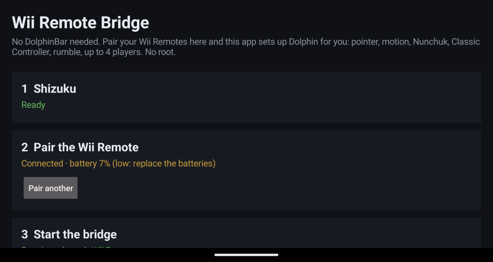

# Wii Remote Bridge

**No DolphinBar needed.** Use real Nintendo Wii Remotes in Dolphin on Android. Pair them in this app
and it sets up Dolphin for you, with the pointer, motion, Nunchuk, Classic Controller and rumble for
up to four players. No root, no USB bar, no mapping screens.

**[Download the APK](../../releases/latest)** · **[How to use (step by step)](docs/GUIDE.md)** · **[Sensor bar help](docs/GUIDE.md#sensor-bar)**

## What you get

| | DolphinBar | Wii Remote Bridge |
|---|---|---|
| Extra hardware | A USB bar (about $30) | None. Your phone, handheld or TV box's own Bluetooth |
| Pairing | Through the bar | In the app: press the red SYNC button |
| Dolphin setup | Set each remote to "Real Wii Remote" | Done automatically |
| Buttons, D-pad | ✅ | ✅ |
| Pointer (sensor bar) | ✅ | ✅ Dolphin sees the remote's own IR camera dots |
| Motion: tilt, swing, shake | ✅ | ✅ The real accelerometer readings |
| Nunchuk, Classic Controller | ✅ | ✅ Detected and switched in Dolphin automatically |
| MotionPlus (gyro) | ✅ | ✅ Wii Remote Plus or the MotionPlus add-on (experimental) |
| Rumble | ✅ | ✅ |
| Players | 4 | 4 |
| Remote speaker | ✅ | ❌ Its sounds play on the device instead (sending them to the remote needs root) |
| Balance Board, guitar, drums | ✅ | ❌ Not yet |

## Setup (about five minutes)

The short version is below. **[The full guide](docs/GUIDE.md)** walks through Shizuku, pairing, the sensor
bar and troubleshooting step by step.

1. Install **[Shizuku](https://shizuku.rikka.app/)** and start it (Wireless debugging, no root).
   Open Wii Remote Bridge and tap **Allow**.
2. **Pair:** tap **Pair** and press the red **SYNC** button under the battery cover. Later, any button
   reconnects. For more players, tap **Pair another**.
3. **Open Dolphin once**, then come back. The app maps every connected remote to Dolphin's Wii Remote
   1–4 by itself. **Set up again** redoes it whenever you want.
4. Put a sensor bar above or below the screen, 1.5–3 m from you. No Wii needed: a USB sensor bar
   works ([options and placement](docs/GUIDE.md#sensor-bar)). The **Test** panel shows the pointer,
   motion, buttons and battery, and has a rumble button.

After a restart, start Shizuku once. The bridge and Dolphin's settings follow by themselves.

## The app takes care of

- **Pairing**, which Android's Bluetooth settings cannot do: a Wii Remote's PIN is a Bluetooth
  address written backwards as raw bytes.
- **Dolphin's configuration:** device names, every button and axis, the IR pass-through, motion
  units, extensions and rumble. It adds new players, follows the Nunchuk or Classic Controller you
  plug in, keeps up when Android renumbers controllers, and replaces mappings from older versions. It
  never interrupts a running game: changes wait until Dolphin is closed.
- **Staying up:** the bridge starts with Shizuku, restarts if it stops, keeps each remote's player
  number across reconnects, and lets go of held buttons when a remote drops out.
- **Retroid handhelds:** their controller remapping replaces new controllers with a copy of the
  built-in pad; the bridge switches that off just while it creates its controllers.
- **Telling you what's wrong:** a missing kernel driver, a remote that needs a device restart, low
  batteries, a sensor bar out of view.

## How it works

Android's kernel already contains the Wii Remote driver (`hid-wiimote`, built into Google's GKI
kernels). After pairing, the driver splits each remote into separate input devices: buttons, IR
camera, accelerometer, MotionPlus and the extension. Android only adopts the one with buttons, so
apps never see the pointer or the motion.

The bridge runs as the shell user through Shizuku. It reads every part of every remote and re-creates
each remote as one complete Android game controller ("Wii Remote 1" to "Wii Remote 4"), and sends
rumble back to the right remote. The axis layout is documented in
[`native/wiibridge.c`](native/wiibridge.c).

## Requirements and limits

- Android 12 or newer with `hid-wiimote` in the kernel. The app tells you if it is missing.
- **Dolphin for Android:** the official build, or forks that keep the `org.dolphinemu` package prefix.
- If a remote connects but no controller appears after a long uptime, restart the device: the driver
  needs a contiguous block of memory when it starts. The app detects this case.
- Low batteries make the pointer jumpy and the connection drop. The app shows the battery level.

## Build

`native/build.sh` builds the bridge for arm64-v8a and x86_64, then run `./gradlew :app:assembleRelease`.

Note: Yes its vibe coded if you have issues with that don't use it, I dont really care at this point enough with rant and stuff.

## License

MIT
